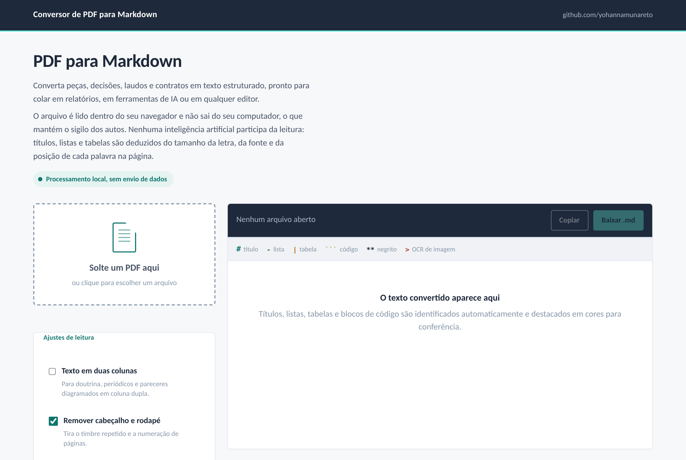

# Conversor de PDF para Markdown com OCR

Transforma autos de processo gigantes, digitados ou escaneados, em Markdown pronto para a IA ler, e aponta exatamente o que precisa ser conferido no original.



> **Sigilo:** a ferramenta nasceu para uso interno num escritório de advocacia. Este repositório não contém nenhum documento, nome de parte, número de processo ou dado pessoal real. Todos os exemplos e testes usam dados fictícios.

## Problema

PDFs de tribunal são enormes, passam de mil páginas, e misturam páginas digitadas com folhas escaneadas de décadas atrás. Ferramentas comuns de extração:

- perdem as páginas escaneadas sem avisar;
- trazem lixo de camadas técnicas invisíveis (assinatura digital, fontes defeituosas);
- não dizem em quais trechos a leitura é confiável.

Na análise de um processo, um CPF, uma data ou um valor lido errado vira um erro de decisão. E os colegas que precisam da ferramenta não têm perfil técnico.

## Solução

Duas formas de uso, para dois perfis de pessoa:

1. **App no navegador** (`src/pdf-para-markdown.html`): um arquivo HTML. A pessoa arrasta o PDF e recebe o Markdown com títulos, listas e tabelas deduzidos do tamanho da letra e da posição das palavras. Nada sai do computador. Para processos grandes, entrega o texto digital em cerca de 1 minuto e lista as páginas escaneadas.
2. **Leitor de Documentos** (`src/ocr-lote.py`, empacotado como `.exe`): lê também as páginas escaneadas, em paralelo, e marca o que precisa de conferência. Vira um executável único que os colegas usam com dois cliques, sem instalar nada.

### O que o Leitor de Documentos faz em cada página

- Usa o texto digital quando ele existe e só aciona o OCR (reconhecimento de texto em imagem) quando precisa.
- Detecta fontes defeituosas (ideogramas no meio das palavras) e lê essas páginas por imagem.
- Desvira páginas escaneadas de lado ou de cabeça para baixo.
- Mede a confiança de cada linha e marca com ⚠ as linhas de leitura fraca.
- Confere CPF e CNPJ pelo dígito verificador, número do processo pela regra do CNJ (Resolução 65/2008) e datas pelo calendário. Número inválido sai marcado.
- Separa páginas de pouco texto legível (carimbo, termo manuscrito, rubrica).
- Guarda o progresso: se fechar no meio, continua de onde parou.

No topo do arquivo vem um resumo com a lista das páginas que precisam ser conferidas no original.

## Resultados

Medidos num processo real de 1.592 páginas, com 616 páginas escaneadas (dados não divulgados), num notebook comum (Intel Core i5 de 4 núcleos):

| Medida | Resultado |
|---|---|
| Páginas convertidas | 1.592 de 1.592, nenhuma vazia |
| Parte digital: CPF, CNPJ, datas e números de processo | 100% iguais ao PDF original |
| Tempo das 616 páginas escaneadas | cerca de 18 minutos (versão inicial: 40) |
| Páginas a conferir no original | 120 (a primeira versão marcava 231) |
| Erros de OCR pegos pela validação | 8 números inválidos, como um CNPJ com o último dígito trocado e datas com mês 42 |

O que **não** deu certo, e ficou registrado:

- Aumentar a resolução e tratar a imagem subiram a confiança só 1 a 2 pontos.
- Outro modo de leitura do Tesseract subiu a confiança de 38% para 57%, mas descartava metade das palavras. Não foi adotado.
- O modelo de português mais preciso (`tessdata_best`) ganhou 1 ponto e ficou 5 vezes mais lento. Também não foi adotado.

O limite está no material: datilografia antiga, cópias carbono, carimbos e manuscritos. Por isso o foco mudou de "subir a confiança" para "apontar com precisão o que conferir".

## Tecnologias

- **Navegador:** HTML e JavaScript, [pdf.js](https://mozilla.github.io/pdf.js/) e [tesseract.js](https://tesseract.projectnaptha.com/)
- **Leitor de Documentos:** Python 3, [Tesseract OCR](https://github.com/tesseract-ocr/tesseract), [Poppler](https://poppler.freedesktop.org/) (pdftotext, pdftoppm), Pillow
- **Executável:** PyInstaller
- **Testes:** pytest, ReportLab e pypdf para gerar PDFs fictícios
- **Desenvolvimento:** Claude (Cowork e Projetos), com vibe coding

## Como instalar e executar

### App no navegador

1. Abra `src/pdf-para-markdown.html` no Chrome ou no Edge.
2. Arraste um PDF para a caixa. Precisa de internet para carregar o pdf.js e o tesseract.js.

### Leitor de Documentos (Windows)

1. Instale o [Python 3](https://www.python.org/downloads/), marcando "Add python.exe to PATH".
2. Instale o [Tesseract](https://github.com/UB-Mannheim/tesseract/wiki) e o [Poppler](https://github.com/oschwartz10612/poppler-windows/releases), e coloque os dois no PATH.
3. Baixe `por.traineddata` e `osd.traineddata` em [tessdata_fast](https://github.com/tesseract-ocr/tessdata_fast) e coloque em `src/tessdata/`.
4. Rode `pip install -r requirements.txt`.
5. Dê dois cliques em `src/conferir.bat` para checar a instalação.
6. Dê dois cliques em `src/reconhecer.bat` e escolha o PDF.

Pela linha de comando:

```bash
python src/ocr-lote.py processo.pdf -o "processo - OCR.md"
python src/ocr-lote.py processo.pdf -o trecho.md --paginas 261-279,320-343
python src/ocr-lote.py processo.pdf -o processo.md --retomar      # continua de onde parou
python src/ocr-lote.py processo.pdf -o processo.md --caprichado   # relê páginas fracas em 400 dpi
```

### Gerar o executável para quem não é técnico

Com o passo anterior pronto, dê dois cliques em `src/montar-executavel.bat`. Em cerca de 7 minutos sai `src/dist/Leitor de Documentos.exe` (por volta de 120 MB), com o Python, o Tesseract, o Poppler e o pacote de português dentro. Quem recebe o arquivo só dá dois cliques.

### Testes

```bash
python tests/gerar_pdfs_teste.py   # cria os PDFs fictícios em data/
pytest tests
```

Os testes de ponta a ponta são pulados se o Tesseract e o Poppler não estiverem instalados.

## Estrutura de pastas

```
pdf-para-markdown-ocr/
├── README.md
├── src/
│   ├── pdf-para-markdown.html   # app no navegador
│   ├── ocr-lote.py              # Leitor de Documentos (OCR em lote e conferência)
│   ├── app_exe.py               # ponto de entrada do executável
│   ├── pdf2md.py                # conversor de linha de comando, só heurísticas
│   ├── verificar.py             # checagem da instalação
│   ├── conferir.bat             # atalho: checar instalação
│   ├── reconhecer.bat           # atalho: converter um PDF
│   ├── montar-executavel.bat    # atalho: gerar o .exe
│   └── tessdata/                # pacotes de idioma (baixar à parte)
├── tests/                       # testes com dados fictícios
├── data/                        # PDFs fictícios e um resultado de exemplo
├── docs/                        # imagens
├── requirements.txt
├── .gitignore                   # bloqueia PDFs, resultados e o .exe
└── LICENSE
```

## Exemplo de uso

Entrada: `data/misto.pdf`, com 3 páginas digitadas e 1 escaneada (fictícias).

Saída (trecho de `data/exemplo-misto - OCR.md`):

```markdown
- Páginas processadas: 4
- Lidas por OCR: 1 (confiança média 95.3%)
- **Páginas a conferir no original: 0**
- Números conferidos pelo dígito verificador ou formato: 1 válidos, 0 inválidos

## Página 4

> **[OCR, confiança 95.3%]**
>
> CERTIDAO DE MATRICULA
> Imovel registrado sob o numero 98.765
> Valor da avaliacao: R$ 450.000,00
> Data: 15/02/2029
```

Numa página com problema, a marcação fica assim:

```markdown
> **[OCR, confiança 58.2%, CONFERIR NO ORIGINAL]**
>
> Valor do contrato: R$ 250.000,00
> ⚠ CNPJ 11.222.333/0001-82 ⚠[inválido]
```

## Como foi desenvolvido

O projeto foi feito com vibe coding: o código foi escrito com ferramentas de IA (Claude), e o meu papel foi conduzir o trabalho:

- **Definição do problema:** o que a equipe jurídica precisa receber, e o que não pode acontecer (perder página em silêncio, número errado sem aviso).
- **Regras de negócio:** quais números importam numa análise de processo, o que conta como "precisa conferir", como tratar carimbos e manuscritos.
- **Decisões técnicas:** duas ferramentas para dois perfis de pessoa, processamento local por sigilo, executável único para quem não é técnico, rejeitar ganhos de confiança que escondiam texto.
- **Testes e validação:** conferência do Markdown contra o PDF original num processo real, medição de tempo no computador de uso diário e testes de regressão a cada mudança.
- **Sigilo e LGPD:** nenhum dado real no repositório. Os testes e exemplos usam documentos fictícios.

## Próximos passos

- Escolher por tipo de documento do processo eletrônico quais páginas ler por OCR.
- Juntar as duas ferramentas num Markdown único, com o texto digital estruturado e o OCR no lugar certo.
- Levar a marcação por linha e a validação de números para o app do navegador.
- Sumário dos eventos do processo no topo do arquivo.
- Remover ruído de margem no OCR.

## Autora

**Yohanna Munareto**, Analista de Automação e Dados

- GitHub: [yohannamunareto](https://github.com/yohannamunareto)
- LinkedIn: [yohanna-munareto](https://linkedin.com/in/yohanna-munareto)
